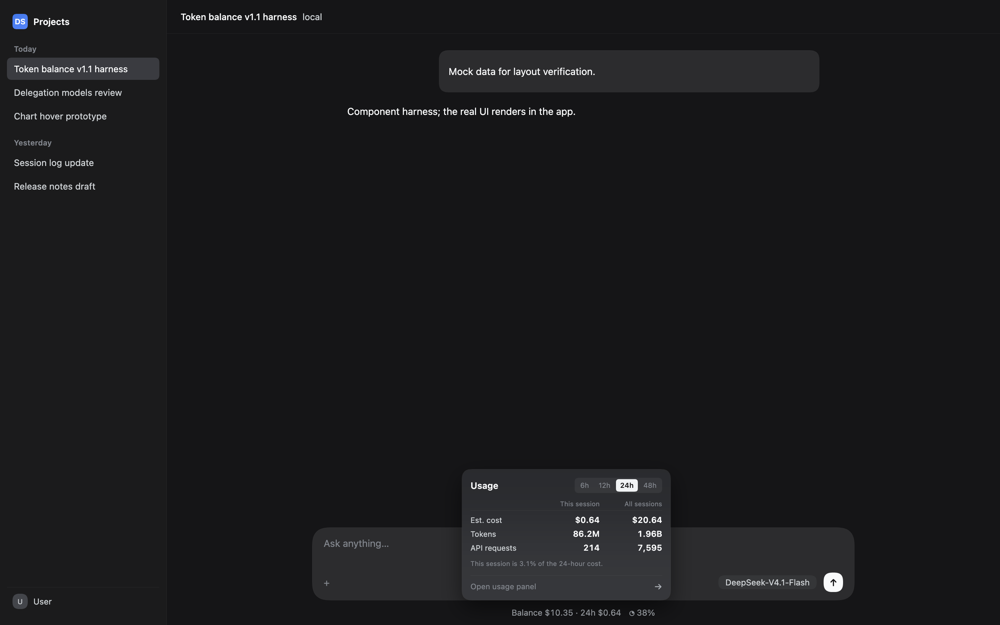
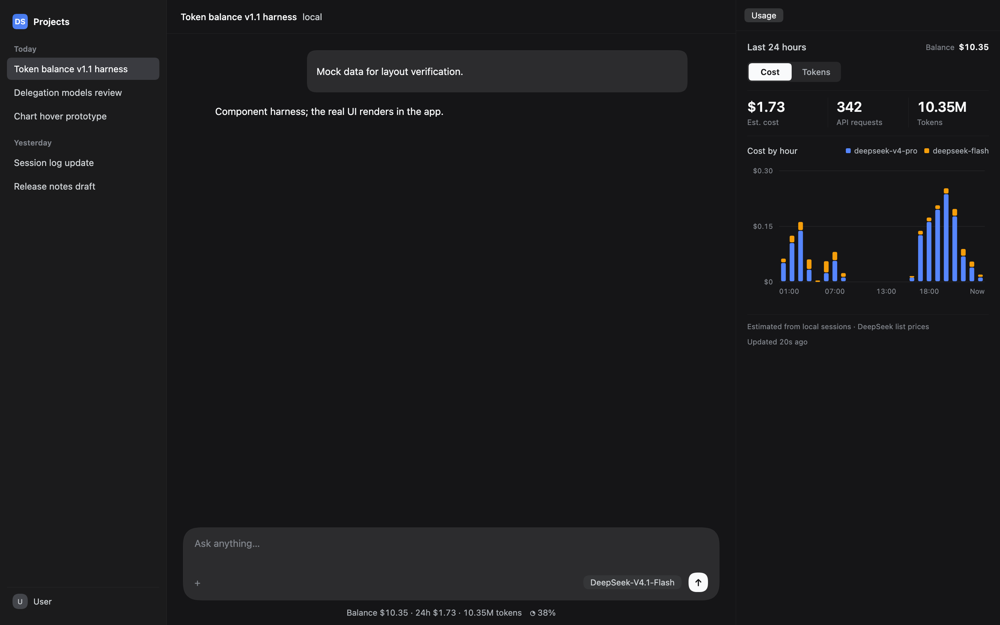
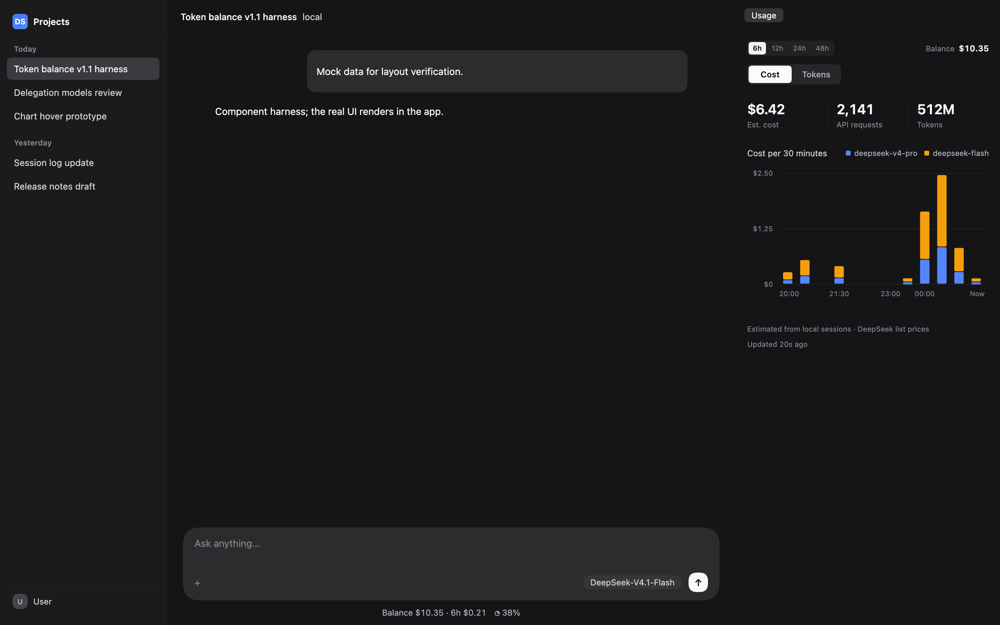
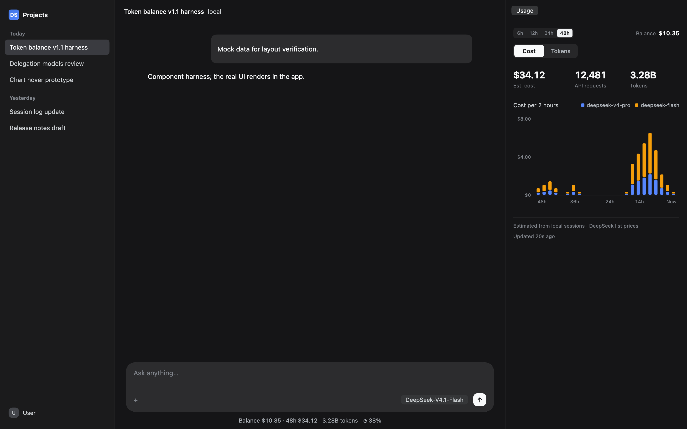

# Token & Balance

[Repository home](../README.md) · [Plugin](../plugins/dsh-token-balance/) · [Rules](../AGENTS.md)

The plugin shows the DeepSeek account balance and local token usage for a selectable
6, 12, 24 or 48-hour window below the composer, with a session comparison on hover
and a full panel in the right sidebar.



More: [6-hour card](concepts/v11-dock-6h.png) · [48-hour card](concepts/v11-dock-48h.png).

## What you see

- **Dock line** under the composer: `Balance $10.35 · 24h $0.64`.
  It shows the balance and **this session's** cost for the selected 6/12/24/48-hour
  window; token totals are not shown in the bar. The dock summary and the panel
  follow the range chosen in the hover card.
- **Hover summary**: this session vs all sessions for the selected window, for cost,
  tokens and API requests, plus this session's share of the window's cost. The range
  selector (6h/12h/24h/48h) lives in the card header and is shared with the panel and
  the dock summary.
- **Usage panel**: click the dock line to open the **Usage** tab in the right Sidebar.
  - **Cost**: estimated spend, API requests and tokens; bars stacked by model.
  - **Tokens**: total, prompt and completion tokens; bars stacked by model.
  - Hover a bar for the bucket's time range, request count, per-model values and total.
  - The range selector is also in the panel header. Bucket size follows the range:
    6/12h = 30 minutes, 24h = 1 hour, 48h = 2 hours; the chart title reflects it.
    48h also uses relative -48h/Now axis labels.
  - The panel is responsive: the chart reflows to the sidebar and pane width.







More: [Tokens tab](concepts/v11-panel-tokens.png) · [bar tooltip](concepts/v11-panel-tooltip.png).

## Data

- **Balance** comes from the signed-in DeepSeek account wallet, or from
  `GET https://api.deepseek.com/user/balance` with the configured API key.
- **Usage** comes from the harness session log through `ctx.sessionQuery` (live and
  persisted sessions), restricted to the selected window. The route accepts
  `?hours=6|12|24|48` and an optional `?sessionId=` for the hover comparison. Without
  that service the plugin falls back to the live sessions' committed events.
- **Cost** is an estimate: token counts × DeepSeek list prices. The table lives in
  [`rates.json`](../plugins/dsh-token-balance/rates.json) and distinguishes
  cache-hit, cache-miss and output tokens at peak and off-peak UTC hours. Edit the
  file and restart the profile to change it, or pass a `rates` object in the plugin
  row's `config` in `cordis.patch.yml`; a config override wins over the file.
  `inputTokens` is treated as cache-miss prompt tokens and `cacheReadTokens` as the
  cache-hit side, matching the harness usage record.

The shipped table was copied from the
[official pricing page](https://api-docs.deepseek.com/quick_start/pricing) (fetched
2026-10-17). Peak hours are 01:00–04:00 and 06:00–10:00 UTC, Monday to Friday;
everything else is off-peak at half price. Chinese public holidays are not modelled.

## Limits

- Sessions are read when they are live or were created inside the window. A session
  created earlier and archived without being live while the plugin ran is not counted.
- The estimate is not the platform's billed amount; it uses list prices and ignores
  discounts, grants and holiday pricing.
- The report is cached for 30 seconds per range/session, and the client polls every
  30 seconds while a view is mounted. A longer range re-reads a session once to pick
  up older events.

## Tests

```sh
cd plugins/dsh-token-balance && node --test
```

The suite covers rate normalization, peak-hour boundaries, per-event cost, rolling
window bucketing, event spellings, and the host route with mocked sessions.
